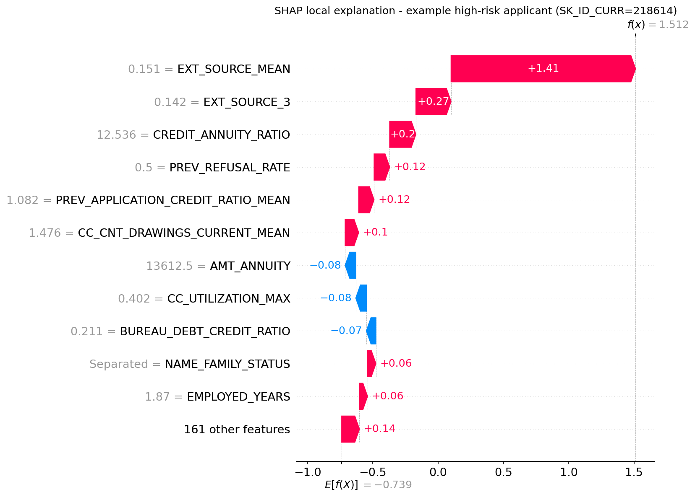
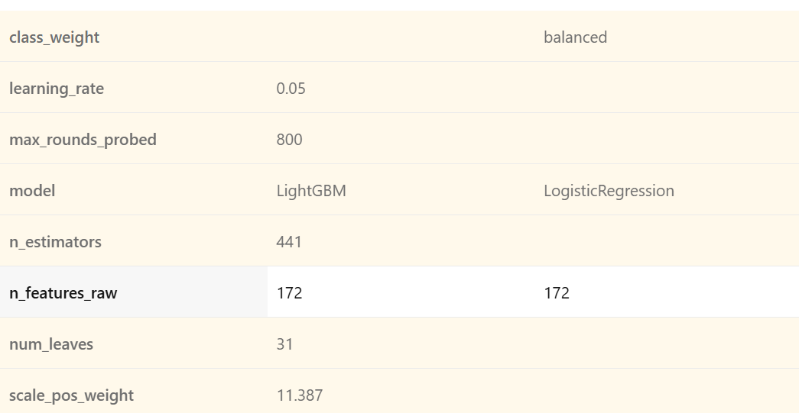
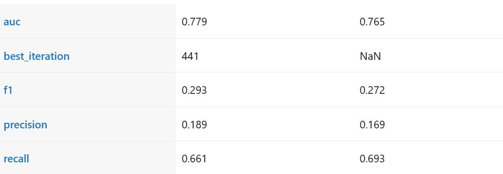
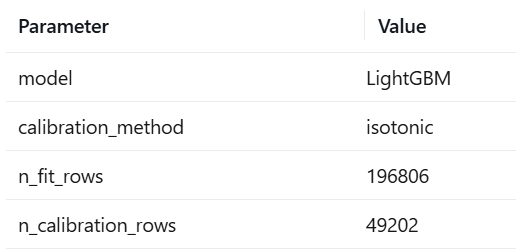
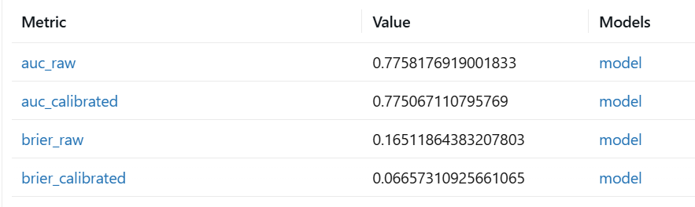

# Credit Risk / Loan Default Predictor
## Project Report

This report covers what I built: the data, the features, the model, calibration, SHAP, the Postgres and SQL analysis, and the Power BI dashboard. I designed a RAG Adverse Action generator and a FastAPI and React application, but I did not build them. They show up below only where I mark them "designed, not built."

You have probably seen a Home Credit Default Risk notebook before. This one differs in three ways. The model is calibrated, so its probabilities mean something. I checked every score in SQL before it reached a dashboard. And a Power BI cutoff slider shows you what each approval threshold costs in approval rate and expected loss.


---

## 1. Executive Summary

Lenders decide at scale who gets credit and how much risk they take on. Each decision has two parts. Will the borrower repay, and can the lender explain a denial in terms the law accepts? Many student credit-risk projects tune a score and stop. This project goes further on both parts. It produces calibrated default probabilities, and it lists the top factors behind each applicant's score.

- **The problem.** A lending decision has to be accurate and explainable at once. A risk score alone doesn't give an applicant the specific reason they need when a lender denies credit.
- **The solution.** A pipeline predicts the probability of default, calibrates it, finds the top factors behind each score, and shows the result in a dashboard where you can move the approval cutoff and see what it costs. Turning those factors into a cited, plain-English notice is designed (Section 4.2) but not built.
- **Key findings.**
  - Loan size alone can't rank risk. On the raw data, Medium loans default at 9.6%, Low at 7.1% and High at 5.9%.
  - Class weighting made the raw probabilities unusable (Brier 0.1706, worse than the 0.0742 you get by guessing the base rate). Isotonic calibration fixed it (0.0665).
  - The external credit scores dominate. `EXT_SOURCE_MEAN` has a mean absolute SHAP value of 0.52, more than 3x the next feature.
  - The model's three segments span a 10x range of predicted default (1.8%, 5.3% and 17.4%).
- **Recommendation.** The cutoff is a business decision, and this report doesn't recommend one value. That would take a cost matrix with loss-given-default, and I haven't built it (Section 5.2). The data does show you the tradeoff. Moving the cutoff from 0.05 to 0.15 raises approval from 47.9% to 85.8% and raises the expected-loss proxy from $436M to $1,611M. Moving from 0.15 to 0.20 buys only 2.8 more points of approval for another $160M. The useful range sits between 0.10 and 0.15.
- **Next steps.** Build the cost matrix and pick a cutoff you can defend. Then add a model card and a fairness audit, and follow the path to deployment in Section 5.4.

Headline results: AUC 0.78 (logistic baseline 0.765), Brier score 0.1706 down to 0.0665 after calibration, and 100% agreement between the Python and SQL segments on 61,503 applicants. I have no explanation-faithfulness score because I didn't build the generator.

---

## 2. Problem Definition and Business Context

### 2.1 Business Challenge

A lender faces two pressures. If it approves too freely, defaults eat into profit. If it approves too tightly, it loses revenue and turns away people who would have repaid. That tradeoff is the real decision the model supports. So I present it as a cutoff choice with a visible cost, not as an abstract accuracy number. The deliverable is a decision-support tool and a way to reason about where to set the threshold. It isn't just a model.

### 2.2 Regulatory Context (Adverse Action Notices)

**U.S. framework.** The Equal Credit Opportunity Act (ECOA) and its Regulation B (12 CFR §1002.9) require a creditor to notify an applicant when it denies the application or offers worse terms than requested. The notice has to give the specific reasons or tell the applicant how to ask for them. The reasons must be specific. Saying the decision rested on "the creditor's internal standards or policies" doesn't meet the rule.

Two CFPB Circulars apply this to AI. Circular 2022-03 asks whether the specific-reasons rule still holds when a complex algorithm makes the reasons harder to find. It does. The circular says "the legal requirement is the same" whether a creditor uses a sophisticated ML model or a simple scorecard. Circular 2023-03 goes further. A creditor can't fall back on Regulation B's sample reasons if they don't reflect what the model actually relied on. It also can't use "overly broad or vague reasons to the extent that they obscure the specific and accurate reasons relied upon." Its example is a credit-line reduction based on spending behavior, where the notice has to name the specific behavior and not a vague label like "purchasing history." Together, the two circulars frame this project. Automation doesn't reduce a creditor's duty to give specific, accurate reasons. It raises the bar for proving them.

**Canadian framework.** OSFI Guideline E-23 (Model Risk Management, 2027) governs federally regulated Canadian financial institutions. OSFI finalized it in September 2025 and it takes effect on May 1, 2027. Unlike the 2017 version, it brings AI and ML models into scope. It adds explainability controls and requires independent validation for any model with non-negligible risk. It names credit-adjudication models as a covered use.

My explainability work targets this gap. SHAP identifies the specific factors behind an individual decision, and that part is built. A RAG layer would ground the explanation in the actual regulatory and policy text. That layer is the designed next step (Section 4.2) and isn't built.

### 2.3 Stakeholders

| Stakeholder | Interest |
|---|---|
| Credit risk team | Accurate, calibrated risk scores that reflect true default likelihood |
| Compliance and legal | Specific denial reasons that satisfy Regulation B and OSFI E-23, plus an audit trail for how each reason was produced |
| Applicants | Fair, understandable decisions and accurate explanations when declined |
| Business and finance leadership | Portfolio-level expected loss, approval-rate tradeoffs, and a clear basis for setting policy |

### 2.4 Success Metrics

I track ML metrics and business metrics. A model with a good AUC but uncalibrated probabilities or ungrounded explanations wouldn't count as a success here.

| Metric | Target | Actual |
|---|---|---|
| AUC | At least 0.75. Strong full solutions to this dataset land around 0.78 to 0.80, and 0.75 is an honest floor for a solo, time-boxed build. | 0.78 (0.7799 tuned, logistic baseline 0.7647) |
| Brier score after calibration | Clearly lower than before calibration, with a tighter reliability diagram | 0.0665 (from 0.1706, base-rate baseline 0.0742) |
| RAGAS faithfulness for Adverse Action explanations | At least 0.80 | Not measured, because I didn't build the generator (Section 4.2) |
| Expected loss reduction at a recommended cutoff | Lower than a no-model baseline, with stated assumptions | Partly met. At cutoff 0.15 the proxy expected loss is 59% of the approve-everyone total while approving 85.8% of applicants (Section 5.3). I haven't tied it to a cost matrix or a recommended cutoff. |

---

## 3. Data and Methodology

### 3.1 Data Source and Description

The data comes from Kaggle's Home Credit Default Risk competition. It is a real, anonymized dataset from Home Credit Group, and it spans several related tables instead of one flat file. That makes the feature engineering worth doing.

- `application_train.csv` is the core table, with one row per loan application (about 307,500 applications and 122 columns). It includes the target, `TARGET`, where 1 means the applicant defaulted and 0 means they repaid.
- `bureau.csv` holds the applicant's credit history from other lenders. It has millions of rows, with many rows per applicant.
- `previous_application.csv` lists the applicant's earlier loan applications with this lender.
- `credit_card_balance.csv` has monthly balance and utilization history on any earlier credit cards with this lender.

The classes are heavily imbalanced. Of the 307,511 applications, 8.07% default and 91.93% don't. This imbalance shapes almost every modeling and evaluation choice in this report. I confirmed the number directly against the raw data in `notebooks/01_eda_application.ipynb`.

### 3.2 Exploratory Data Analysis

The full analysis, code and plots live in `notebooks/01_eda_application.ipynb`. Four findings changed what I did later.

**1. Class imbalance.** A model that always predicts "no default" would look 92% accurate and be useless. For that reason I use AUC, PR-AUC, precision and recall and skip accuracy (Sections 2.4 and 3.4).

**2. Missing data carries signal.** Applicants with no bureau record (14.3% of the training set) default at 10.12%. Applicants with a record default at 7.73%. That gap of about 2.4 points fits thin-file and first-time borrowers being a different risk profile. It doesn't look like a data-entry gap. So I added an explicit `HAS_BUREAU_HISTORY` flag and didn't silently fill in the bureau columns.

**3. `DAYS_EMPLOYED` has a placeholder value that predicts default.** 18.0% of applicants carry the value 365,243 (about 1,000 years). It almost certainly stands for "not currently employed," such as pensioners. That group defaults at 5.40%, against 8.66% for everyone else. They are safer, not noisier. I replaced the placeholder with NaN and added an `IS_DAYS_EMPLOYED_ANOMALY` flag. Without that step, a model would read "employed for 1,000 years" as a huge, meaningless number.

**4. The three external bureau scores are the strongest linear predictors I checked.** Correlation with `TARGET` is -0.179 for `EXT_SOURCE_3`, -0.160 for `EXT_SOURCE_2` and -0.155 for `EXT_SOURCE_1`. Raw income sits at -0.004 and raw credit amount at -0.030. These are third-party scores that Home Credit handed over as inputs. So my job was to add value on top of them with the auxiliary tables (Section 3.3), not to beat them from scratch. Missingness differs a lot across the three (`EXT_SOURCE_1` is 56.4% missing, `EXT_SOURCE_3` is 19.8% and `EXT_SOURCE_2` is 0.2%). That affects how much a tree model can lean on each one.

Before I trained any model, I wrote down five hypotheses about the SHAP rankings in the notebook. That lets Section 4.1 check the real output against a prior I set in advance and not against a story I made up afterward.

### 3.3 Feature Engineering

The auxiliary tables hold most of the predictive signal. An applicant's form says less than their credit history and behavior do. I aggregate each auxiliary table to one row per applicant with a group-by and join it onto the application table.

`ml/pipeline/features.py` adds 52 engineered columns to the 122 raw ones. It takes in 307,511 rows and returns 307,511 rows, because every left join has one row per applicant on both sides.

| Feature group | Source table | Why | Example correlation with `TARGET` |
|---|---|---|---|
| Bureau credit history (credit count, active-credit ratio, overdue amounts, debt-to-credit ratio, `HAS_BUREAU_HISTORY`) | `bureau.csv` | Overdue or defaulted credit elsewhere is one of the strongest signals of future default | `BUREAU_ACTIVE_RATIO` +0.077, `BUREAU_DEBT_CREDIT_RATIO` +0.060 |
| Previous application outcomes (approval and refusal rate, requested vs. granted amount, recency) | `previous_application.csv` | Past behavior with this lender is a direct signal that bureau data doesn't give you | `PREV_REFUSAL_RATE` +0.078, `PREV_APPROVAL_RATE` -0.064 |
| Credit card utilization (mean and max balance-to-limit ratio, late-payment rate) | `credit_card_balance.csv` | High or rising utilization often comes before financial distress | `CC_UTILIZATION_MEAN` +0.136, the strongest new feature after the `EXT_SOURCE` aggregate |
| Applicant ratios and cleaning (`CREDIT_INCOME_RATIO`, `ANNUITY_INCOME_RATIO`, cleaned `DAYS_EMPLOYED` with anomaly flag, age and employment in years) | `application_train.csv` | Raw income and credit amount are weak alone. The ratios and cleaned fields carry more. | `AGE_YEARS` -0.078, `IS_DAYS_EMPLOYED_ANOMALY` -0.046 |
| `EXT_SOURCE` consensus (row-wise mean, standard deviation and count across the three scores) | `application_train.csv` | The three scores have very different missingness, so averaging whichever exist gives one fuller score | `EXT_SOURCE_MEAN` -0.222, stronger than any single raw score (best was -0.179) |

**Data-quality bugs I caught.** Two ratio features divided by a legitimately zero denominator and produced `inf`. One was `BUREAU_AMT_CREDIT_SUM_SUM` for a small group of applicants with only closed or written-off credit lines. The other was `AMT_APPLICATION` for some `previous_application.csv` rows. An explicit check for infinite values across the whole table found both. I fixed them by treating a zero denominator as "ratio undefined" (`NaN`). LightGBM handles `NaN` natively when it looks for splits. It doesn't handle `inf`, and the `inf` values would have broken training or produced nonsense splits without any warning.

### 3.4 Model Selection and Experimentation

I train two models and report whichever generalizes better on held-out data, not whichever has the nicer training number. Logistic regression is the interpretable baseline. It also works as a sanity check, since you can read its coefficients without SHAP. LightGBM is the main candidate. I chose it over a neural network because gradient-boosted trees usually win on tabular data with well-built features at this scale. It also pairs with `TreeExplainer` (Section 4.1), which gives fast, exact SHAP values for tree models.

Both models train on an 80/20 stratified split of the feature table (246,008 train rows and 61,503 validation rows, each keeping the 8.07% default rate). I handle the imbalance with class weighting and not resampling. Logistic regression uses `class_weight="balanced"`. LightGBM uses `scale_pos_weight`, set to the train split's actual majority-to-minority ratio of about 11.4. I report precision, recall and F1 at a fixed 0.5 threshold only so you can compare the two models. Section 5.2 covers the real business threshold.

| Model | AUC (val) | PR-AUC (val) | Precision | Recall | F1 |
|---|---|---|---|---|---|
| Logistic regression (baseline) | 0.7647 | 0.250 | 0.169 | 0.693 | 0.272 |
| LightGBM (tuned) | 0.7799 | 0.273 | 0.187 | 0.673 | 0.292 |

LightGBM beats the baseline on AUC by 0.015. A single LightGBM run on 52 engineered features lands near the 0.79 to 0.80 that full ensembles report in the reference repos. I report PR-AUC next to AUC on purpose. At an 8% default rate, ROC-AUC is dominated by the large non-default class and can look strong on the minority class I care about. The PR-AUC gap (0.250 vs. 0.273, a 9% relative difference) is bigger than the AUC gap (0.7647 vs. 0.7799, a 2% relative difference). So AUC understates LightGBM's real advantage on the rare class. I tracked both runs in MLflow (`ml/modeling/train.py`, experiment `credit-risk-phase5`, local SQLite backend at `mlflow.db`).

**A debugging finding I want to record honestly.** LightGBM 4.7.0's early-stopping callback picked the worst validation round, iteration 1, as the best one. The validation AUC curve was improving the whole time. It only happened when I set `scale_pos_weight`. Removing that setting alone restored normal behavior. That points to a bug in this release's early-stopping direction detection under sample weighting, not a modeling error. My fix in `train.py` trains 800 rounds without the automatic callback. It reads the validation AUC curve from `evals_result_`, picks the true best iteration by hand, and trains a second model on exactly that many rounds. The first AUC I saw (0.7245) was below the logistic baseline, and I treated it as a bug to chase and not as a result to report. That is what caught the problem.

**Tuning and cross-validation.** I didn't use LightGBM's default settings. I ran a `RandomizedSearchCV` (`StratifiedKFold` with 3 folds and 8 candidates, scored on PR-AUC) over `num_leaves`, `learning_rate` and `min_child_samples`. I held `n_estimators` fixed during the search and found it afterward with the same manual probe. The search chose `num_leaves=15` (down from the starting 31), `learning_rate=0.05` and `min_child_samples=100`. That is a shallower, more cautious tree, with `n_estimators=765`. It moved validation PR-AUC from 0.272 to 0.273 and AUC to 0.7799, a small but real gain. To check that this wasn't luck from one split, I cross-validated the final setup with 3 stratified folds. Mean AUC was 0.7727 (standard deviation 0.0006) and mean PR-AUC was 0.2591 (standard deviation 0.0032). The folds barely differ, so the configuration is stable.

*A build note.* My first version of the search set `n_jobs=-1` on both `RandomizedSearchCV` and the `LGBMClassifier` inside it. That created roughly 15 to 18 competing worker processes, and the search ran far slower than a serial run would have. The fix was to parallelize at one level only: `n_jobs=-1` on the outer search and `n_jobs=1` on the inner model.

### 3.5 Model Calibration

AUC tells you how well a model ranks applicants. It says nothing about whether the predicted probabilities are right. For a real lending decision, like setting a cutoff, pricing a loan or estimating portfolio loss, the probability itself matters.

**Method: diagnose first, then decide.** I don't assume calibration is needed. `ml/modeling/calibration.py` runs a diagnostic on the validation set before it fits anything. It calibrates only if the diagnostic says the raw output strays far enough from the diagonal to matter.

1. **Brier score against a trivial baseline.** I compare the raw Brier score with the score of a model that always predicts the base default rate (`base_rate × (1 − base_rate)`). A model that scores worse than that does worse than doing nothing. That is a clear sign of miscalibration, not a judgment call.
2. **Expected Calibration Error (ECE).** This is the mean absolute gap between predicted and observed default rate across 10 equal-count bins of the reliability diagram. A gap above 0.05 (5 percentage points) counts as large, because the business reads this probability directly as a default rate.

If either check fails, the pipeline fits isotonic regression on a dedicated calibration slice of 49,202 rows. I carve that slice out of the training data. It isn't the validation set. Evaluating on the same data I calibrate on would only prove the calibrator memorized it. The 61,503-row validation set is the same one Phase 5 used. The classifier's training, the diagnostic and the calibrator's fit never touched it. I chose isotonic regression over Platt (sigmoid) scaling for two reasons. The calibration slice is large enough that a flexible, non-parametric fit won't overfit. And I had no reason to think the distortion was sigmoid-shaped.

**Diagnostic result** (`ml/modeling/calibration.py`, tuned LightGBM from Section 3.4):

| Check | Raw LightGBM | Threshold | Verdict |
|---|---|---|---|
| Brier score | 0.1706 | Base-rate baseline 0.0742 | Worse than baseline |
| ECE | 0.2871 | Above 0.05 | Off the diagonal |

Both checks failed by a wide margin. The raw Brier score is more than double the baseline, and the ECE is nearly 6x the limit. The cause is specific and predictable. Phase 5's `scale_pos_weight` of about 11.4 helps the model rank the minority class under 8% imbalance, but it pushes the raw output away from the true base rate. Calibration undoes a known side effect of an earlier, deliberate choice. The held-out data confirms it, so I didn't have to take it on theory.

**Results after calibrating:**

| | Raw LightGBM | Isotonic-calibrated |
|---|---|---|
| AUC | 0.7776 | 0.7774 |
| PR-AUC | 0.2731 | 0.2615 |
| Brier score | 0.1706 | 0.0665 |


The diagram shows the raw model (blue) overpredicting risk across the whole range. The gap from the dotted diagonal widens as the predicted probability rises. The calibrated curve (orange) follows the diagonal closely. So the Brier improvement (0.1706 down to 0.0665, now better than the 0.0742 baseline) comes from the whole range and not from a lucky bin or two. AUC moved by only -0.0002. Isotonic regression can keep or flatten the ranking through ties and can never reverse it. So a tiny drop is the expected result, and its size shows calibration left the ranking nearly untouched.

PR-AUC does move (0.2731 down to 0.2615, a real 4% relative drop), even though isotonic regression keeps the order. That isn't a contradiction. Isotonic regression fits a step function, so many different raw scores collapse onto one calibrated value wherever the steps are flat. AUC averages over all pairwise comparisons, so a modest number of ties barely changes it. PR-AUC depends on precision at the top of the ranking, where positives are few and the steps are coarsest. So calibration slightly hurts fine-grained ranking among the riskiest applicants. That is the price of fixing the probabilities. It isn't free, and you should know about it.

---

## 4. Explainability and Regulatory Compliance

### 4.1 SHAP Analysis (Global and Local)

I use SHAP (Shapley Additive exPlanations) because it has a principled basis. Each feature's attribution reflects its marginal contribution to the prediction, averaged over all orderings of the features. That is stronger than an ad hoc importance score. I use `TreeExplainer` because LightGBM is tree-based, and for trees it is both exact and fast.

I produce two views. A global summary plot shows which features matter most across the validation set. Local explanations show individual predictions, mainly declined applicants, since those would feed the Adverse Action generator in Section 4.2.

**One seam to be clear about.** SHAP explains the raw LightGBM output (log-odds of default), not the isotonic-calibrated probability from Section 3.5. Isotonic calibration is a step function wrapped around the tree model's output, and `TreeExplainer` has no tree structure to attach to. So these explanations tell you why the tree model scored an applicant as risky. Calibration then rescales the probability and doesn't change which features drove the decision.

**Global results** (`ml/explain/shap_analysis.py`, full validation set):


`EXT_SOURCE_MEAN`, the consensus feature from Section 3.3, dominates. Its mean absolute SHAP value is 0.52, more than 3x the next feature (`ORGANIZATION_TYPE` at 0.15). Low values push the predicted risk up, which is the direction I expected. This confirms the EDA hypothesis from Section 3.2 and shows the feature-engineering choice in Section 3.3 paid off. `CREDIT_ANNUITY_RATIO` and `PREV_APPLICATION_CREDIT_RATIO_MEAN` also rank in the top 10. Both are engineered ratios and not raw columns. That repeats the pattern from Section 3.3: derived ratios beat the raw values they come from.

**Local example.** The applicant below (SK_ID_CURR 218614) has a calibrated probability of default of 0.30. That sits well inside the top-10% risk band I used to pick examples for this phase. The code explains why I used that band and not the business cutoff.



For this applicant, a low `EXT_SOURCE_MEAN` (0.151) adds +1.41 to the log-odds of default. That is by far the largest factor. A low `EXT_SOURCE_3` (+0.27) comes next, then a high `CREDIT_ANNUITY_RATIO` of 12.5 (+0.20), which means the loan spans about 12.5 annuity payments. I saved the top-3 factors for every applicant in the top 10% of calibrated risk (6,679 applicants) to `reports/top_shap_factors.json`, with each applicant's feature value next to its SHAP contribution. That file feeds the `top_shap_factor_1..3` columns I write to Postgres in Phase 8 (Section 5). It is also the designed input to the generator in Section 4.2. "Top-3 factors" means the three largest positive SHAP values, the ones that pushed the prediction most toward default. It doesn't mean the three most negative numbers, which would mean the opposite.

### 4.2 Adverse Action Notice Generator (Designed, Not Built)

I did not build this. I chose to put my time into the SQL and Power BI work instead. What exists today is the input the generator would use: the top-3 SHAP factors per applicant (Section 4.1), stored in Postgres and shown in the dashboard. The project doesn't generate, retrieve or score any notice text, and it has no RAGAS numbers.

The design would answer the regulatory gap in Section 2.2. For a declined applicant, it would work in four steps.

1. SHAP finds the top-3 factors pushing that applicant toward default.
2. Those factors become a retrieval query against a curated corpus. The corpus holds the text of 12 CFR §1002.9, CFPB's published model Adverse Action notice forms, and a short policy document I would write to explain each model feature in plain English.
3. An LLM writes a specific, plain-English explanation grounded in the retrieved text.
4. RAGAS's faithfulness metric checks that the explanation only claims what the retrieved text supports and doesn't invent plausible-sounding detail.

A real deployment would also need legal and compliance sign-off on the policy corpus and human review of generated notices. This design is a pattern. It isn't a compliance-certified system (see Section 8).

---

## 5. Business Case and Recommendations

### 5.1 Risk Segmentation

I group applicants into risk bands by calibrated probability of default. That turns an individual score into something a business can act on at policy level, such as auto-approving the low band, reviewing the medium band and declining the high band.

**As built,** the bands are tertiles of the calibrated PD on the 61,503-applicant validation set (`score_and_write.py`). They aren't fixed probability thresholds, so each band holds about a third of applicants by construction. These model-based bands contrast with the raw `AMT_CREDIT` bands on the Phase 0.5 dashboard page, which failed to rank risk (Section 7).

| Segment | Applicants | Avg calibrated PD | PD range | Avg credit amount |
|---|---|---|---|---|
| Low | 21,155 | 1.80% | 0.0% to 2.6% | $635,160 |
| Medium | 20,515 | 5.26% | 3.0% to 8.3% | $615,058 |
| High | 19,833 | 17.40% | 8.6% to 99.8% | $540,027 |

Two points stand out. The PD spread from Low to High is about 10x, far wider than loan size gave (5.9% to 9.6%). And the High segment has the smallest average loan, so a "flag big loans" rule would point the wrong way. The table shows the model's predicted default rate per segment. I did not tabulate the observed default rate per segment against the true `TARGET`. That is the natural next check. Overall calibration (Section 3.5) already shows the predictions track observed rates.

### 5.2 Risk-Return Tradeoff Analysis

The approval cutoff is a business decision and not only a statistical one. A stricter cutoff cuts expected losses but also rejects applicants who would have repaid, which costs revenue. A looser cutoff approves more revenue-generating applicants and takes on more expected loss. The right way to pick is an explicit cost matrix with a dollar cost, or a stated assumption, for each of four outcomes:

| Outcome | Meaning | Cost or benefit |
|---|---|---|
| True positive | Correctly declined a defaulter | Loss avoided |
| False positive | Wrongly declined a good applicant | Lost revenue (estimated margin on the loan you didn't make) |
| True negative | Correctly approved a good applicant | Normal profit |
| False negative | Approved someone who defaults | Actual dollar loss (average loan size × loss-given-default rate) |

**I haven't set the dollar values for this matrix.** I assumed no loss-given-default rate and no opportunity-cost margin. So the analysis below uses a simpler proxy: calibrated PD × `amt_credit`, summed over approved applicants. This measures exposure-weighted expected default. It isn't a loss forecast. It ignores recoveries, and it ignores the revenue lost on declined good applicants (the false-positive cost above). It ranks cutoffs correctly in direction, but it can't tell you which cutoff is best.

The table below shows the tradeoff across the ten cutoffs that `business/sql/cutoff_tradeoff.sql` sweeps. An applicant counts as approved when their calibrated PD falls below the cutoff. I recomputed these figures from the scored table, and they match the SQL and the dashboard.

| Cutoff | Approval rate | Avg predicted PD among approved | Expected loss proxy |
|---|---|---|---|
| 0.05 | 47.9% | 2.34% | $436M |
| 0.10 | 70.6% | 3.72% | $993M |
| 0.15 | 85.8% | 5.18% | $1,611M |
| 0.20 | 88.6% | 5.55% | $1,771M |
| 0.25 | 94.5% | 6.49% | $2,158M |
| 0.30 | 97.6% | 7.14% | $2,413M |
| 0.35 | 98.0% | 7.25% | $2,455M |
| 0.40 | 99.3% | 7.66% | $2,607M |
| 0.45 | 99.4% | 7.69% | $2,619M |
| 0.50 | 99.6% | 7.78% | $2,647M |

The dashboard opens at 0.15. I mark it here for reference and not as a recommendation. The table shows big gains early and small gains late. The first 0.05 of cutoff buys 48 points of approval. From 0.30 up, the whole remaining range adds only 2 points of approval (97.6% to 99.6%) and about $234M of proxy loss. With a real cost matrix, the decision would land somewhere between 0.10 and 0.25.

### 5.3 Financial Impact Projection

Here I turn the cutoff analysis into an illustrative dollar estimate. The target form is "at the chosen cutoff, expected portfolio loss falls by about $X per 1,000 applications against an approve-everyone baseline, at the cost of Y fewer approvals."

**Result on the proxy and the 61,503-applicant validation set.** Approving everyone carries a total proxy expected loss of $2,714M. At the dashboard's default cutoff of 0.15, the model approves 85.8% of applicants (52,778) and carries $1,611M. That is 59% of the approve-everyone loss for 86% of the approvals. Per 1,000 applications, declining the riskiest 14% removes about $17.9M of proxy expected loss and costs 142 approvals. At a stricter 0.10 cutoff, you approve 70.6% and the proxy loss falls to $993M, which is 37% of the total.

**Assumptions, so you don't over-read this.** Loss equals PD × `amt_credit` with no loss-given-default, so real loss would be lower per default. The estimate counts no revenue from approved loans. It assigns no cost to wrongly declined good applicants. And it covers only the held-out validation set, not a full loan book. Treat it as a direction and not a forecast.

### 5.4 Implementation Roadmap

If a lender wanted to deploy this system for real, I would expect a path like this:

| Phase | Duration | Focus | KPIs to track |
|---|---|---|---|
| Pilot | 1 to 3 months | Shadow mode. Run alongside current underwriting without acting on the output, to check calibration on live applicants. | Calibration drift, override rate (how often the model would disagree with human decisions) |
| Controlled rollout | 3 to 6 months | A/B test on a subset of new applications. Compliance and legal review the fairness properties and the policy corpus. | Approval rate, default rate, time-to-decision, override rate |
| Full deployment | 6 to 12 months | Phased integration into underwriting, with continued monitoring | Portfolio expected loss vs. baseline, drift alerts, notice faithfulness rate |

I include this roadmap because a working prototype and a production system in a regulated industry are different things. It also lines up with OSFI E-23's expectation of independent validation before a model with non-negligible risk goes live (Section 2.2).

---

## 6. Technical Implementation

### 6.1 System Architecture

**As built,** the system is a batch pipeline with one script per stage:

```
data/raw (CSVs)
  -> ml/pipeline/features.py         multi-table aggregation, writes features.parquet
  -> ml/modeling/train.py            logistic baseline + LightGBM, tuning, CV, MLflow
  -> ml/modeling/calibration.py      diagnose, then isotonic calibration
  -> ml/explain/shap_analysis.py     global + local SHAP, top-3 factors
  -> ml/modeling/score_and_write.py  score 61,503 held-out applicants into Postgres `scored_applications`
  -> business/sql/*.sql              segment, cutoff and validation analysis
  -> business/powerbi/credit_risk    Power BI project (Import mode) and dashboard
```

**Designed, not built.** I planned a serving and compliance layer on top. It would hold a RAG generator (retrieval over the compliance corpus in pgvector, grounded generation and a RAGAS faithfulness check, Section 4.2) behind a FastAPI service. That service would feed a React frontend where an applicant enters their details. I would keep that frontend separate from the Power BI dashboard. The dashboard is for the internal risk team and shows portfolio-wide data. An applicant-facing tool should only show that applicant's own decision. Merging the two would create an access-control problem that doesn't need to exist.

### 6.2 API Endpoints (Planned Design, Not Built)

No API exists yet. This table is the interface I would build for the serving layer in Section 6.1.

| Endpoint | Method | Example input | Example output |
|---|---|---|---|
| `/predict` | POST | `{"applicant_id": 1234, "features": {...}}` | `{"probability_of_default": 0.12, "calibrated": true, "recommendation": "approve"}` |
| `/explain/{id}` | GET | Applicant ID | `{"top_factors": [{"feature": "DEBT_TO_INCOME", "shap_value": 0.34}, ...], "global_importance_url": "..."}` |
| `/adverse-action/{id}` | GET | Applicant ID | `{"reasons": [...], "retrieved_sources": [...], "faithfulness_score": 0.87}` |
| `/chat` | POST | `{"applicant_id": 1234, "preset_question": "what_can_i_do"}` | `{"answer": "...", "retrieved_sources": [...], "faithfulness_score": 0.87}`. The applicant frontend's preset-question panel would call it (Section 6.1). It wouldn't be an open chat box. |
| `/health` | GET | None | `{"status": "ok"}` |

### 6.3 Deployment (Docker Built, Azure Planned)

**Built.** `docker-compose.yml` runs Postgres 16 locally with `docker compose up -d postgres`. It exposes the database on host port 5433. The container still listens on 5432 inside. I changed the host port because another service on my Windows machine already held 5432 and quietly took over Docker's mapping. The symptom was a password failure from the host with a password that worked inside the container. That pointed to a port collision and not to wrong credentials. The compose file defines only the `postgres` service.

**Planned.** I would containerize a FastAPI backend and deploy it to Azure App Service. There is no live demo URL.

---

## 7. Dashboard (Power BI)

The Power BI dashboard is what a non-technical stakeholder would use. I store it as a text-based Power BI Project in `business/powerbi/` (`credit_risk.pbip`, `credit_risk.Report/` and `credit_risk.SemanticModel/`), so git shows clean diffs. I don't commit the binary `.pbix`, because Import mode embeds the underlying rows. The dashboard has two pages.

### 7.1 Page 1: Before the model, what the raw data shows

This page uses a 25,000-row stratified slice of `application_train` that keeps the true 8.07% default rate. A `RiskBand` calculated column splits `AMT_CREDIT` at the slice's 25th and 75th percentiles (270,000 and 808,650). Measures give default rate, average credit amount and default rate by band.


| Band (by credit amount) | Default rate | Avg credit | Applicants |
|---|---|---|---|
| Low (270K or less) | 7.1% | $197K | 6,396 |
| Medium | 9.6% | $524K | 12,447 |
| High (above 808.65K) | 5.9% | $1.17M | 6,157 |

Default rate doesn't rise with loan size. The largest loans are the safest. A rule like "flag big loans" gets it backwards, and that is the concrete case for building a model instead of a threshold.

### 7.2 Page 2: After the model, who is risky and where to set the cutoff

This page reads the `scored_applications` table from Postgres in Import mode (61,503 applicants). `RiskSegment` is a dimension table with a one-to-many, single-direction relationship to the scored fact table.


- **Cutoff slider.** A What-if parameter runs from 0.05 to 0.50 in steps of 0.05, with a default of 0.15. A disconnected `Cutoff` table backs it, and `SELECTEDVALUE` reads the chosen value into the measures.
- **KPI cards.** They show Approval Rate at Cutoff (0.86 at the default), Expected Loss ($1,611M), Expected Loss Rate (4.99%) and average calibrated PD.
- **Curves.** Approval rate and expected-loss rate run across the full cutoff axis. They draw the same tradeoff that `cutoff_tradeoff.sql` computes in SQL, using a finer 0.01-step axis table.
- **Segment bar chart and detail table.** They show average calibrated PD of 1.80%, 5.26% and 17.40%, applicant counts of 21,155, 20,515 and 19,833, and each segment's share of expected loss at the selected cutoff.
- **Top reasons for High-risk applicants.** This chart counts the most common top SHAP factor in the High segment. `EXT_SOURCE_MEAN` leads by a wide margin (about 14.1K of 19.8K). `PREV_CNT_PAYMENT_MEAN`, `CREDIT_ANNUITY_RATIO`, `CODE_GENDER` and `CC_CNT_DRAWINGS_CURRENT_MEAN` trail far behind.

**What you do with it.** Drag the slider and watch two numbers pull against each other. At 0.15 the book approves 86% of applicants and carries a proxy expected loss of $1.6B. Slide to 0.10 and you approve 71% and the proxy loss drops to about $1.0B. That turns "what cutoff should we use?" from a modeling question into a policy discussion with the cost in view. You never have to open a notebook. A notebook chart stays fixed, while a dashboard lets you explore segments and thresholds on your own.

**What the dashboard doesn't do.**
- It has no fairness view. `CODE_GENDER` appears as a top SHAP factor for some applicants, and a real deployment would have to examine that under ECOA's anti-discrimination rules. A demographic-slice view for compliance audits would be a fairness monitoring tool and not an input to the lending decision. I haven't built it.
- It has no model-performance page (ROC, precision-recall, confusion matrix), no time-series or drift view, and no loan-type or region filters.
- Expected Loss is a proxy (PD × `amt_credit`, no loss-given-default, no cost matrix), as Section 5.2 explains.
- It has no scheduled refresh. In Desktop, Refresh re-runs the Postgres query after I re-run the scoring script. A scheduled refresh in the Power BI service would do the same on a timer. It would also need a gateway, because this Postgres instance runs locally. I haven't published the report.

---

## 8. Conclusion and Next Steps

**What worked well**
- **Diagnosing before calibrating.** I compared the raw Brier score with the base-rate baseline (0.1706 vs. 0.0742). That turned "probably needs calibration" into a measured fact. It also showed that my class-weighting choice had distorted every probability.
- **Treating a suspicious result as a bug.** The first LightGBM AUC (0.7245, below the baseline) led me to the early-stopping defect in Section 3.4. Otherwise I might have concluded that boosting didn't help.
- **Validating in SQL before visualizing.** The Python and SQL segmentations agreed on all 61,503 rows. The SQL cutoff sweep gave the numbers the Power BI measures had to match. I reproduced the dashboard's $1,611M at cutoff 0.15 from the scored table on its own.
- **Letting the dashboard challenge an assumption.** The raw-data page showed that loan size doesn't rank risk. That is the reason for the modeling phases.

**Where it fell short or is incomplete**
- Calibration has a cost. PR-AUC fell from 0.2731 to 0.2615 (Section 3.5).
- `shap_analysis.py` still reproduces an earlier hyperparameter set (441 trees, 31 leaves). The final model in `calibration.py` and `score_and_write.py` uses 765 trees and 15 leaves. I should close this gap by importing one shared config.
- Expected loss is a proxy with no cost matrix, so I can't recommend a specific cutoff yet.
- I didn't build the Adverse Action generator or the API. The explainability half of the problem is met only as a ranked list of factors.

**Limits that hold no matter what the results say**
- The Home Credit data comes from a 2018 Kaggle competition. It reflects lending patterns and economic conditions from that period. A real deployment would need current, proprietary lending data.
- I scored only the 61,503-applicant validation set, not the full book.
- Any generated Adverse Action text would show the pattern and wouldn't be a compliance-certified system. A real deployment needs legal review of the policy corpus and human sign-off on the notices (Sections 4.2 and 5.4).
- I ran no fairness or disparate-impact audit across protected classes. ECOA's anti-discrimination rules require one before any real deployment. Nobody independent has validated the model either, which OSFI E-23 expects.

**With three more months, in this order:**
1. Build a cost matrix with loss-given-default, pick a cutoff I can defend, and write a one-page business memo.
2. Write a model card and run a fairness audit, starting with the `CODE_GENDER` factor.
3. Add a shared model config to close the reproducibility gap, and add drift monitoring on the scored table.
4. Only then build the RAG notice generator and the serving layer.

---

## 9. Appendices

### Appendix A: Code Repository and Notebooks
https://github.com/darang1412/credit-verdict

| Area | Location |
|---|---|
| Feature engineering | `ml/pipeline/features.py` |
| Training, tuning, MLflow | `ml/modeling/train.py` |
| Calibration | `ml/modeling/calibration.py` |
| SHAP | `ml/explain/shap_analysis.py` |
| Scoring to Postgres | `ml/modeling/score_and_write.py` |
| SQL analysis | `business/sql/` |
| Power BI project | `business/powerbi/credit_risk.pbip` |
| Notebooks | `notebooks/01_eda_application.ipynb`, `02_feature_check.ipynb` |

### Appendix B: MLflow Experiment Logs

These screenshots come from the `credit-risk-phase5` experiment, which compares the `lightgbm` and `logistic_regression_baseline` runs (left and right columns in both screenshots).

**Parameters.** LightGBM's `num_leaves=15`, `learning_rate=0.05` and `min_child_samples=100` come from the search in Section 3.4. `n_estimators=765` is the manually corrected best iteration for that shape. `scale_pos_weight=11.387` and `class_weight=balanced` are each model's imbalance correction.

> **The screenshots below are out of date.** I took them before the Section 3.4 hyperparameter search and the Section 3.5 rewrite. They still show the earlier `n_estimators=441, num_leaves=31` run and the earlier calibration numbers. I need to retake all four from the MLflow UI (`mlflow ui --backend-store-uri sqlite:///mlflow.db`) using the current `lightgbm`, `lightgbm_hpo`, `lightgbm_cv_check` and `lightgbm_calibration` runs. The text in this appendix already shows the current numbers. Only the image files need replacing.



**Metrics.** These are the AUC, PR-AUC, precision, recall and F1 numbers from Section 3.4, taken straight from MLflow and not retyped.



The Phase 6 calibration run lives in the same experiment as `lightgbm_calibration`.

**Parameters.** `n_fit_rows` (196,806) and `n_calibration_rows` (49,202) confirm that I used the dedicated calibration slice from Section 3.5 and not the full training set or the validation set. `calibration_applied=True` records that the diagnostic gate fired. Isotonic regression didn't run by default.



**Metrics.** These match the before and after numbers in Section 3.5. AUC stays almost the same (0.7776 raw, 0.7774 calibrated). The Brier score drops by more than half and passes the base-rate baseline (0.1706 raw, 0.0665 calibrated, 0.0742 baseline). The PR-AUC cost shows up too (0.2731 raw, 0.2615 calibrated).



### Appendix C: Additional Visualizations

All figures live in `reports/figures/` and appear where I discuss them: the reliability diagram (Section 3.5), the SHAP global summary and local waterfall (Section 4.1), and the two dashboard pages (Section 7). The MLflow screenshots above appear only in this appendix.
