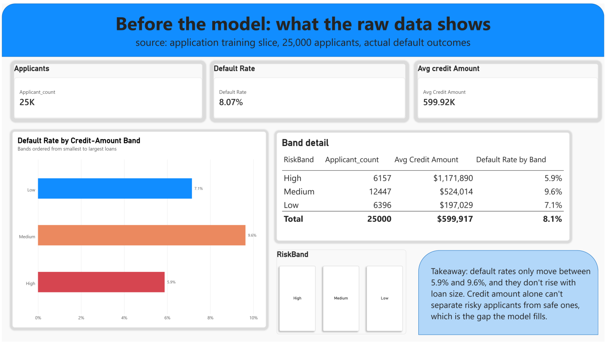
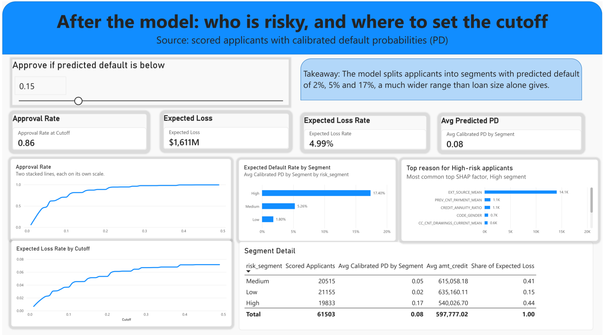
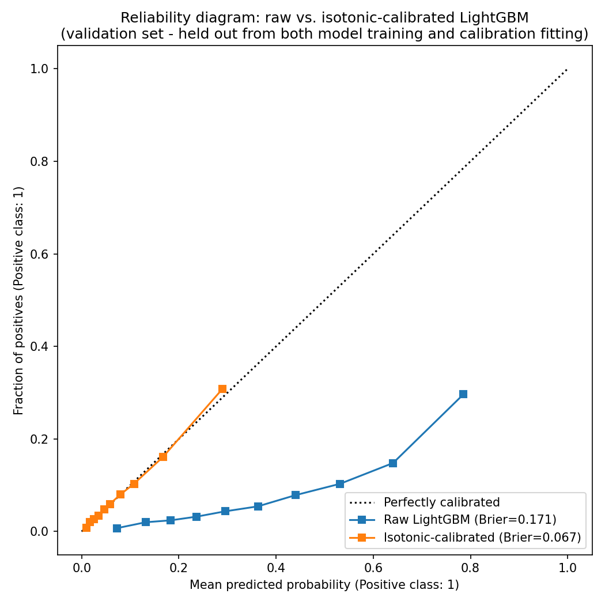
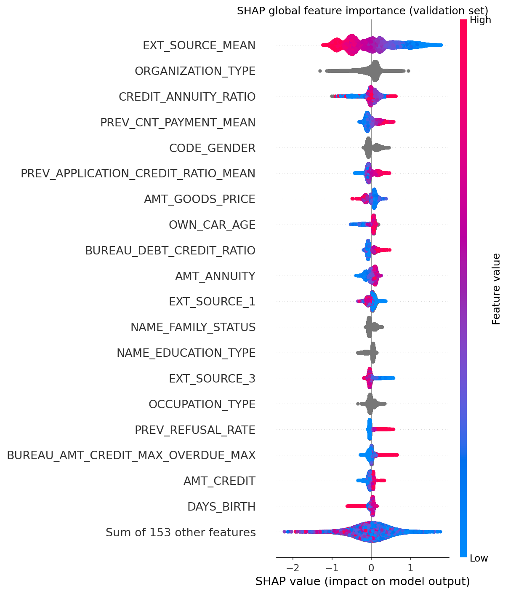

# Credit Verdict
[](LICENSE) [](https://python.org)

You have probably seen a Home Credit Default Risk notebook before. This one does three things differently. It calibrates the model's probabilities instead of stopping at AUC. It checks every score in SQL before the score reaches a dashboard. And it gives you a Power BI cutoff slider, so you can see what an approval threshold costs in approval rate and expected loss.




## Table of Contents
- [Overview](#overview)
- [Status](#status)
- [Results](#results)
- [Key Findings](#key-findings)
- [Pipeline](#pipeline)
- [SQL Analysis](#sql-analysis)
- [Power BI Dashboard](#power-bi-dashboard)
- [Tech Stack](#tech-stack)
- [Quick Start](#quick-start)
- [Project Structure](#project-structure)
- [Limitations](#limitations)
- [Dataset](#dataset)
- [Reference](#reference)
- [License](#license)

## Overview

Credit Verdict predicts loan default on Kaggle's [Home Credit Default Risk](https://www.kaggle.com/c/home-credit-default-risk) dataset. The project starts from one business question:

> How should a lender decide who to approve, so expected loss stays under control, good applicants don't get turned away, and every decline has a reason you can explain?

The project has three parts:

- **Calibrated risk scoring.** A LightGBM classifier beats a logistic regression baseline. Isotonic regression then calibrates it, so a 12% predicted probability of default means about 12%.
- **Explainability.** SHAP shows the top factors that push each applicant toward default. Regulation B (ECOA) and OSFI E-23 expect specific reasons for a denial, so a score alone isn't enough.
- **Decision support.** The scored applicants go into Postgres, get analyzed in SQL, and show up in a Power BI dashboard with an interactive cutoff.

## Status

- [x] Phase 0: Project scaffolding
- [x] Phase 0.5: Power BI fast-track on a stratified 25,000-row slice
- [x] Phase 1-2: ML fundamentals, credit-risk and regulatory research
- [x] Phase 3: Exploratory data analysis
- [x] Phase 4: Feature engineering (52 new columns from three auxiliary tables)
- [x] Phase 5: Model training, tuning and MLflow tracking
- [x] Phase 6: Calibration
- [x] Phase 7: SHAP explainability
- [x] Phase 8: Scoring to Postgres and SQL analysis
- [x] Phase 9: Power BI dashboard connected to Postgres

## Results

| Metric | Value |
|---|---|
| Dataset | 307,511 loan applications, 8.07% default rate |
| Features | 122 raw, plus 52 engineered from `bureau`, `previous_application` and `credit_card_balance` |
| AUC (validation) | 0.780 LightGBM (tuned) vs. 0.765 logistic regression |
| PR-AUC (validation) | 0.273 LightGBM vs. 0.250 logistic regression |
| Brier score, raw | 0.1706 (worse than the 0.0742 base-rate baseline) |
| Brier score, calibrated | 0.0665 |
| Average predicted PD by segment | Low 1.8%, Medium 5.3%, High 17.4% (about a 10x spread) |
| Python vs. SQL segment check | 100% match on 61,503 applicants |

AUC isn't the headline here. Calibration matters just as much. You can read the code in [`ml/modeling/calibration.py`](ml/modeling/calibration.py) and see the reliability diagram below.



The Phase 5 model (AUC 0.7799) trains on the full 80% training split. The Phase 6 model (AUC 0.7776) gives up 20% of that split to fit the calibrator. The two numbers describe different models.

## Key Findings

1. **A simple rule can't rank risk.** In the raw data, default rate by loan size doesn't rise or fall in a straight line. Medium loans default at 9.6%, Low at 7.1% and High at 5.9%. Credit amount alone can't separate risky applicants from safe ones, and that gap is where the model helps.
2. **Class weighting breaks probabilities.** The `scale_pos_weight` setting (about 11.4) helps ranking but pushes the raw output far from the true default rate. The Brier score came out more than double the "always predict the base rate" baseline. Isotonic calibration fixed it (0.1706 down to 0.0665). It cost a little PR-AUC (0.2731 down to 0.2615).
3. **External credit scores dominate.** `EXT_SOURCE_MEAN` averages three bureau scores. Its mean absolute SHAP value is 0.52, more than 3x the next feature. Engineered ratios beat the raw columns they come from.



4. **Missing data carries signal.** Applicants with no bureau record default at 10.12%, against 7.73% for the rest. The `DAYS_EMPLOYED = 365243` placeholder covers 18% of rows and marks a safer group (5.40% vs. 8.66%).
5. **The cutoff is a business choice.** At a cutoff of 0.05, you approve 47.9% of applicants and carry about $436M of expected loss. At 0.50, you approve 99.6% and carry about $2.65B. The dashboard opens at 0.15, which approves 86%.

## Pipeline

```
data/raw (CSVs)
  -> ml/pipeline/features.py        multi-table aggregation, writes data/processed/features.parquet
  -> ml/modeling/train.py           logistic baseline + LightGBM, tuning, CV, MLflow
  -> ml/modeling/calibration.py     diagnose, then isotonic calibration, reliability diagram
  -> ml/explain/shap_analysis.py    global + local SHAP, writes reports/top_shap_factors.json
  -> ml/modeling/score_and_write.py score 61,503 held-out applicants into Postgres `scored_applications`
  -> business/sql/*.sql             segment, cutoff and validation analysis
  -> business/powerbi/credit_risk   Power BI project reading Postgres
```

A few engineering choices are worth knowing about:

- **Stratified splits** keep the 8.07% default rate in both train and validation. The project weights classes instead of resampling, because resampling changes the base rate that calibration relies on.
- **Calibration runs only when the diagnostic fails.** The script fits isotonic regression if the Brier score is worse than the base-rate baseline or if ECE is above 0.05. It logs `calibration_applied` to MLflow, so you can audit the decision. The calibrator trains on its own slice, not the validation set.
- **LightGBM 4.7.0 has an early-stopping bug.** With `scale_pos_weight` set, the callback picked iteration 1 as the best (AUC 0.7245, below the baseline). `train.py` now trains 800 rounds, reads the validation curve and picks the best iteration itself (765).
- **Data-quality fixes.** Zero denominators made `inf` values in two ratio features, so the code treats them as `NaN`. The `DAYS_EMPLOYED` placeholder becomes `NaN` plus an anomaly flag.
- **SHAP explains the raw LightGBM model**, not the isotonic wrapper. It tells you what drove the score, not what the calibration step did.

## SQL Analysis

[`business/sql/`](business/sql/) holds four queries. Each uses a different technique and runs against the live `scored_applications` table.

| File | Technique | Question |
|---|---|---|
| `segment_summary.sql` | `GROUP BY` | How risky and how large is each segment? |
| `cutoff_tradeoff.sql` | `generate_series` + conditional `LEFT JOIN` | What do approval rate and expected loss look like across ten cutoffs? |
| `top_risk_per_segment.sql` | `ROW_NUMBER() OVER (PARTITION BY ...)` | Who is riskiest in each segment, and why? |
| `validate_segmentation_in_sql.sql` | `PERCENTILE_CONT ... WITHIN GROUP` | Do the Python segments match an independent SQL recomputation? |

## Power BI Dashboard

The dashboard lives in [`business/powerbi/`](business/powerbi/) as a text-based Power BI Project (PBIP). That format lets git show you clean diffs.

```
business/powerbi/
├── credit_risk.pbip              # entry point, open this in Power BI Desktop
├── credit_risk.Report/           # pages and visuals
└── credit_risk.SemanticModel/    # tables, relationships, DAX measures (TMDL)
```

Keep all three together. The report points to the semantic model by relative path.

**Page 1, "Before the model."** It uses a 25,000-row stratified slice of the raw application data. A `RiskBand` calculated column splits `AMT_CREDIT` by quartile, and measures give you default rate and average credit amount. The page shows that loan size alone doesn't rank risk.

**Page 2, "After the model."** It reads `scored_applications` from Postgres in Import mode.
- A What-if cutoff slider drives `Approval Rate at Cutoff` and `Expected Loss`. The slider is a disconnected `Cutoff` table read through `SELECTEDVALUE`. A separate `Cutoff Axis` table feeds the line chart.
- The page shows expected-loss rate by cutoff, a segment bar chart, a segment detail table (with each segment's share of expected loss) and the top SHAP factor for high-risk applicants.
- `RiskSegment` is a dimension table with a one-to-many, single-direction relationship to the scored fact table.
- `Expected Loss` equals PD times `amt_credit`. It has no loss-given-default and no cost matrix, so treat it as a rough proxy and not a forecast.

**To open it,** turn on *Power BI Project (.pbip)* under Options, then Preview features. Start Postgres (see Quick Start) and open `credit_risk.pbip`. Page 1 reads a CSV from a path on the author's machine. Re-point it under Transform Data, then Source, to your own `data/interim/application_train_powerbi_slice.csv`. Create that file like this:

```python
import pandas as pd
from sklearn.model_selection import train_test_split
df = pd.read_csv("data/raw/application_train.csv")
_, s = train_test_split(df, test_size=25_000, stratify=df["TARGET"], random_state=42)
s.to_csv("data/interim/application_train_powerbi_slice.csv", index=False)
```

The repo leaves out the binary `.pbix` on purpose. In Import mode it embeds the underlying rows.

## Tech Stack

- Python: pandas, scikit-learn, LightGBM, SHAP, MLflow, SQLAlchemy
- PostgreSQL 16 in Docker
- SQL: `generate_series`, window functions, `PERCENTILE_CONT`
- Power BI Desktop: Power Query, DAX (`CALCULATE`, `SUMX`, `SELECTEDVALUE`), What-if parameters

## Quick Start

### Prerequisites
- Python 3.13. Earlier 3.10+ versions haven't been tested against the pinned packages.
- Docker
- Power BI Desktop (Windows) if you want to open the dashboard
- The Home Credit CSVs from Kaggle, saved in `data/raw/`

### Installation
```bash
git clone https://github.com/darang1412/credit-verdict.git
cd credit-verdict

python -m venv .venv
source .venv/bin/activate  # Windows: .venv\Scripts\activate
pip install -r requirements.txt

cp .env.example .env       # then edit values if you need to
```

### Run the pipeline
```bash
docker compose up -d postgres          # Postgres on host port 5433

python ml/pipeline/features.py         # writes data/processed/features.parquet
python ml/modeling/train.py            # logistic baseline + LightGBM, logged to MLflow
python ml/modeling/calibration.py      # diagnostic + isotonic calibration
python ml/explain/shap_analysis.py     # SHAP plots + reports/top_shap_factors.json
python ml/modeling/score_and_write.py  # writes `scored_applications` to Postgres

mlflow ui --backend-store-uri sqlite:///mlflow.db   # inspect runs
```

Run the queries in `business/sql/` against the `credit_risk` database (host `127.0.0.1`, port `5433`).

> **Port note:** Postgres maps to host port 5433, not 5432. Another service on the author's Windows machine already held 5432 and quietly took over Docker's mapping. If you don't have that conflict, change the port in `docker-compose.yml`.

## Project Structure

```
.
├── data/                     # raw/interim/processed/external (gitignored, regenerate via ml/pipeline)
├── notebooks/                # 01_eda_application, 02_feature_check
├── ml/
│   ├── pipeline/             # features.py: multi-table feature engineering
│   ├── modeling/             # train.py, calibration.py, score_and_write.py
│   └── explain/              # shap_analysis.py
├── business/
│   ├── sql/                  # four Postgres analysis queries
│   └── powerbi/              # PBIP project: .pbip + .Report + .SemanticModel
├── reports/                  # figures (dashboard, calibration, SHAP, MLflow) + top_shap_factors.json
├── models/                   # serialized model artifacts (gitignored)
├── CreditRisk_Project_Report.md    # full project report
├── docker-compose.yml
└── requirements.txt
```

## Limitations

- **The data is from 2018.** Lending patterns and economic conditions have changed since then.
- **Scoring covers the held-out set only.** That is 61,503 applicants, not all 307,511.
- **Expected loss is a proxy.** It multiplies PD by credit amount. It has no loss-given-default and no cost matrix, so the project can't yet justify one specific cutoff.
- **There is no fairness audit.** Any real deployment would need a disparate-impact review under ECOA first.
- **No independent party validated the model.** OSFI Guideline E-23 expects that for credit models, and this is a solo portfolio build.

## Dataset

[Home Credit Default Risk](https://www.kaggle.com/c/home-credit-default-risk) on Kaggle: `application_train`, `bureau`, `previous_application`, `credit_card_balance`. This repo doesn't include the data (see `.gitignore`). Download it under Kaggle's terms.

## Reference

- 12 CFR §1002.9 (Regulation B / ECOA) and CFPB Circulars 2022-03 and 2023-03 on AI/ML credit decisions and the specific-reasons requirement
- OSFI Guideline E-23, Model Risk Management (2027)
- Feature-engineering and imbalance-handling references: [kozodoi/Kaggle_Home_Credit](https://github.com/kozodoi/Kaggle_Home_Credit), [jamesdellinger/kaggle_home_credit_default_risk_competition](https://github.com/jamesdellinger/kaggle_home_credit_default_risk_competition), [Bougeant/Home_Credit_default_risk](https://github.com/Bougeant/Home_Credit_default_risk), [NoxMoon/home-credit-default-risk](https://github.com/NoxMoon/home-credit-default-risk)
- Chip Huyen, *Designing Machine Learning Systems*

## License

This project uses the MIT License. See [LICENSE](LICENSE) for details.
